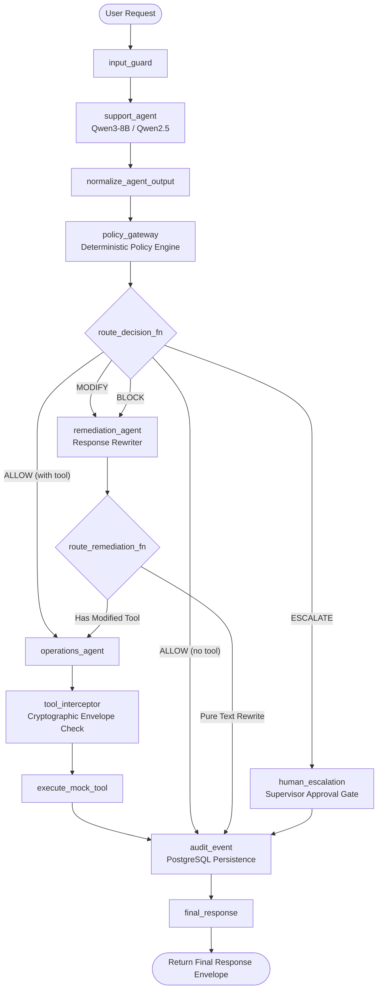

# AegisAI Multi-Agent Workflow & Request Lifecycle

## 1. Executive Summary & Graph Architecture

AegisAI implements a security-enforcing policy gateway for conversational AI agents operating in enterprise e-commerce environments. Orchestrated using **LangGraph** (`StateGraph`), the system governs every turn between customer inquiries, LLM tool proposals, deterministic security policies, tool interception, incident logging, and human governance.

Ground truth definition: [`backend/app/graph/workflow.py`](file:///C:/Users/Hemashri/.gemini/antigravity/scratch/PolicySentinel/backend/app/graph/workflow.py) and [`backend/app/graph/nodes.py`](file:///C:/Users/Hemashri/.gemini/antigravity/scratch/PolicySentinel/backend/app/graph/nodes.py).

### Graph Topology Diagram



---

## 2. Request Lifecycle Trace (Example: Customer Refund Request)

To illustrate the exact execution path, we trace a customer refund turn:  
**Input:** `"Please refund ₹400 for my order ORD-101"` (or over-limit `"Please refund ₹3,000 for my order ORD-101"`).

### Step-by-Step Node Execution

| Step | Node Name | Implementation | Engine / Mechanism | PostgreSQL Operations | Input State Key $\rightarrow$ Output State Key |
| :--- | :--- | :--- | :--- | :--- | :--- |
| **1** | `input_guard` | `node_input_guard` in [`nodes.py:21`](file:///C:/Users/Hemashri/.gemini/antigravity/scratch/PolicySentinel/backend/app/graph/nodes.py#L21) | **Deterministic Python**: Sanitizes inputs, strips whitespace, validates non-empty payload. | None | `customer_message` $\rightarrow$ Validated payload / error short-circuit. |
| **2** | `support_agent` (Agent A) | `node_support_agent` in [`nodes.py:33`](file:///C:/Users/Hemashri/.gemini/antigravity/scratch/PolicySentinel/backend/app/graph/nodes.py#L33) calls `SupportAgentA.process_customer_turn` | **LLM Inference**: Calls Ollama (`qwen2.5:7b` / Qwen3-8B) with `AGENT_A_SYSTEM_PROMPT`. | Pre-loaded context in API entrypoint (`context_service.load_context` from `customer_contexts` table). | `customer_message`, `conversation_context` $\rightarrow$ `agent_a_response`, `proposed_action`. |
| **3** | `normalize_agent_output` | `node_normalize_agent_output` in [`nodes.py:52`](file:///C:/Users/Hemashri/.gemini/antigravity/scratch/PolicySentinel/backend/app/graph/nodes.py#L52) | **Deterministic Python**: Validates and casts Agent A's JSON tool proposal to Pydantic `ProposedAction` schema. | None | `proposed_action` dict $\rightarrow$ Structured `ProposedAction(tool_name="issue_refund", arguments={"order_id": "ORD-101", "amount": 400.0})`. |
| **4** | `policy_gateway` | `node_policy_gateway` in [`nodes.py:66`](file:///C:/Users/Hemashri/.gemini/antigravity/scratch/PolicySentinel/backend/app/graph/nodes.py#L66) calls `policy_engine.evaluate` | **Deterministic Python**: Evaluates 12 YAML security policies against message, proposed tool, and context. Generates cryptographic `AuthorizationEnvelope` on `ALLOW`/`MODIFY`. | None in node (context evaluation in-memory). | `proposed_action`, `conversation_context` $\rightarrow$ `policy_decision`, `approved_action` (`AuthorizationEnvelope`). |
| **5** | Conditional Edge Router | `route_decision_fn` in [`nodes.py:106`](file:///C:/Users/Hemashri/.gemini/antigravity/scratch/PolicySentinel/backend/app/graph/nodes.py#L106) | **Deterministic Python Router**: Evaluates `policy_decision.decision`. | None | Directs flow to `operations_agent`, `remediation_agent`, `human_escalation`, or `audit_event`. |
| **6A** | `operations_agent` (Agent B) *(ALLOW Path)* | `node_operations_agent` in [`nodes.py:134`](file:///C:/Users/Hemashri/.gemini/antigravity/scratch/PolicySentinel/backend/app/graph/nodes.py#L134) calls `OperationsAgentB.prepare_execution_action` | **Deterministic Python**: Isolates execution environment. Constructs concrete tool invocation matching the `AuthorizationEnvelope`. | None | `approved_action` $\rightarrow$ `agent_b_action`, `agent_b_called=True`. |
| **6B** | `remediation_agent` *(BLOCK/MODIFY Path)* | `node_remediation_agent` in [`nodes.py:188`](file:///C:/Users/Hemashri/.gemini/antigravity/scratch/PolicySentinel/backend/app/graph/nodes.py#L188) calls `remediate_response` | **Deterministic Python / Templated Remediation**: Rewrites hallucinated/unsafe responses into policy-compliant safe messaging with actionable fix hints. | None | `policy_decision`, `agent_a_response` $\rightarrow$ `corrected_response`, `final_response`, `agent_b_called=False`, `tool_executed=False`. |
| **6C** | `human_escalation` *(ESCALATE Path)* | `node_human_escalation` in [`nodes.py:216`](file:///C:/Users/Hemashri/.gemini/antigravity/scratch/PolicySentinel/backend/app/graph/nodes.py#L216) | **Deterministic Python**: Enters an approval-gate state. Suppresses automated tool execution, sets status to pending manager review. | None (Incident recorded in `audit_event`). | `policy_decision` $\rightarrow$ `final_response` (escalation notice), `agent_b_called=False`, `tool_executed=False`. |
| **7** | `tool_interceptor` *(ALLOW Path)* | `node_tool_interceptor` in [`nodes.py:151`](file:///C:/Users/Hemashri/.gemini/antigravity/scratch/PolicySentinel/backend/app/graph/nodes.py#L151) calls `ToolInterceptor.verify_and_execute` | **Deterministic Python Security Interceptor**: Enforces 100% strict exact matching between `approved_action.allowed_arguments` and Agent B's `agent_b_action.arguments`. | None | `approved_action`, `agent_b_action` $\rightarrow$ `tool_executed=True`, `tool_result={"status": "success", "refund_id": "REF-..."}`. |
| **8** | `execute_mock_tool` | `node_execute_mock_tool` in [`nodes.py:184`](file:///C:/Users/Hemashri/.gemini/antigravity/scratch/PolicySentinel/backend/app/graph/nodes.py#L184) | **Deterministic Python**: Passthrough pipeline stage ensuring completion of execution barrier. | None | Unchanged state. |
| **9** | `audit_event` | `node_audit_event` in [`nodes.py:238`](file:///C:/Users/Hemashri/.gemini/antigravity/scratch/PolicySentinel/backend/app/graph/nodes.py#L238) calls `audit_service`, `incident_service`, `approval_service` | **Deterministic Python**: Synchronous database persistence layer for audit trails, security incidents, and approval queues. | **Writes to PostgreSQL**:<br>• `audit_events` table (all turns)<br>• `incidents` table (`BLOCK`, `ESCALATE`, `HIGH`/`CRITICAL` severity)<br>• `approvals` table (`REFUND_LIMIT_001` blocks pending supervisor sign-off). | Full turn state $\rightarrow$ `audit_event` record summary, `incident_id`. |
| **10** | `final_response` | `node_final_response` in [`nodes.py:338`](file:///C:/Users/Hemashri/.gemini/antigravity/scratch/PolicySentinel/backend/app/graph/nodes.py#L338) | **Deterministic Python**: Formats and synthesizes user-facing response envelope with status indicators and verification context. | None | `final_response` $\rightarrow$ End of LangGraph graph. |

---

## 3. Conditional Edge Branching Logic

Conditional routing occurs at two explicit junction points in `workflow.py`:

### A. Primary Gateway Routing (`route_decision_fn`)
Grounded in [`backend/app/graph/nodes.py:106`](file:///C:/Users/Hemashri/.gemini/antigravity/scratch/PolicySentinel/backend/app/graph/nodes.py#L106):
```python
def route_decision_fn(state: PolicyState) -> str:
    if state.get("error"):
        return "final_response"
        
    dec_dict = state.get("policy_decision") or {}
    decision = dec_dict.get("decision", "ALLOW")
    
    if decision == "ALLOW":
        if state.get("approved_action"):
            return "operations_agent"    # Tool execution path
        else:
            return "audit_event"        # Pure conversational ALLOW path
    elif decision == "MODIFY":
        return "remediation_agent"       # Rewrite response / modify parameters
    elif decision == "BLOCK":
        return "remediation_agent"       # Rewrite response to safe refusal
    elif decision == "ESCALATE":
        return "human_escalation"        # Supervisor review gate
    return "audit_event"
```

### B. Remediation Continuation Routing (`route_remediation_fn`)
Grounded in [`backend/app/graph/nodes.py:126`](file:///C:/Users/Hemashri/.gemini/antigravity/scratch/PolicySentinel/backend/app/graph/nodes.py#L126):
```python
def route_remediation_fn(state: PolicyState) -> str:
    dec_dict = state.get("policy_decision") or {}
    decision = dec_dict.get("decision", "BLOCK")
    if decision == "MODIFY" and state.get("approved_action"):
        return "operations_agent"       # Proceed with sanitized tool call
    return "audit_event"                # Direct to audit logging (BLOCK path)
```

---

## 4. Architectural Comparison: Implementation vs. Conceptual 5-Agent Model

The evaluation report describes a conceptual 5-agent architecture. Ground-truth code inspection reveals that the actual operational implementation is an **11-node security-governed pipeline**.

### Detailed Divergence Report

| Conceptual 5-Agent Model | Real LangGraph Implementation | Architectural Rationale & Implementation Details |
| :--- | :--- | :--- |
| **1. Customer-Service Agent** | • `input_guard`<br>• `support_agent` (Agent A)<br>• `normalize_agent_output` | **Security Splitting**: Decomposed into 3 nodes. `input_guard` rejects malformed payloads before LLM invocation, `support_agent` executes Qwen3-8B/Qwen2.5, and `normalize_agent_output` enforces Pydantic schema validation so malformed LLM outputs cannot corrupt downstream nodes. |
| **2. Policy Evaluation Agent** | • `policy_gateway`<br>• `operations_agent` (Agent B)<br>• `tool_interceptor`<br>• `execute_mock_tool` | **Zero-Trust Separation of Duties**: Instead of a monolithic evaluator, the gateway is separated from execution. `policy_gateway` issues a cryptographically signed `AuthorizationEnvelope`. `operations_agent` (Agent B) acts as the execution agent, and `tool_interceptor` enforces exact argument invariant verification before calling `execute_mock_tool`. |
| **3. Remediation Agent** | • `remediation_agent` | **Direct 1:1 Match**: Implemented in [`backend/app/agents/remediation.py`](file:///C:/Users/Hemashri/.gemini/antigravity/scratch/PolicySentinel/backend/app/agents/remediation.py). Handles both `BLOCK` (safe refusal with fix hints) and `MODIFY` (stripping unverified promises). |
| **4. Incident Analysis Agent** | Handled synchronously in `node_audit_event` via `incident_service` | **Synchronous Service Pattern**: Rather than spawning an asynchronous sub-agent node in LangGraph, incident analysis and database recording (`incidents` table) occur directly inside `node_audit_event` to guarantee ACID auditability before returning the response. |
| **5. Human Escalation Agent** | • `human_escalation`<br>• `approval_service` in `node_audit_event` | **Approval-Gate State Pattern**: Implemented as a stateful approval barrier. `node_human_escalation` sets the state to `ESCALATED_PENDING_APPROVAL`, while `node_audit_event` populates the `approvals` and `incidents` tables for dashboard review. |
| *(Omitted in 5-agent diagram)* | • `final_response` | **Envelope Synthesizer**: Explicit terminal node that formats the final response payload, attaches execution metadata, and closes the LangGraph state. |

---

## 5. PostgreSQL Database Operations & Audit Persistence

AegisAI utilizes PostgreSQL (via SQLAlchemy in [`backend/app/database.py`](file:///C:/Users/Hemashri/.gemini/antigravity/scratch/PolicySentinel/backend/app/database.py)) for persistent state:

1. **`customer_contexts` table**:
   - Read during API request initialization (`context_service.load_context`).
   - Updated after turn execution (`set_verification`, `update_context_for_refund`, `increment_complaints`).
2. **`audit_events` table**:
   - Synchronously written by `node_audit_event` for **every request**, logging `request_id`, `conversation_id`, `customer_id`, `policy_id`, `decision`, `severity`, `tool_executed`, and full payload evidence.
3. **`incidents` table**:
   - Populated on any `BLOCK` or `ESCALATE` decision, or any request triggering `HIGH` / `CRITICAL` severity policies.
4. **`approvals` table**:
   - Populated when over-limit requests (such as `REFUND_LIMIT_001` > ₹500) are flagged for supervisor authorization.
