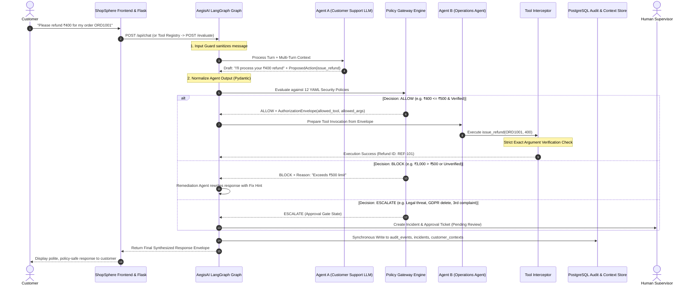

# Project Tech Stack & System Workflow Specification

**Project Overview:** AegisAI (PolicySentinel) Multi-Agent Policy Enforcement Gateway & ShopSphere E-Commerce System  
**Document Version:** 1.0.0  
**Generated Date:** 2026-10-03  

---

## 1. High-Level Architecture Overview

The system consists of two primary applications working in tandem:
1. **AegisAI (PolicySentinel)**: A zero-trust, multi-agent policy gateway orchestrating deterministic security guardrails, cryptographic authorization envelopes, and compliance logging.
2. **ShopSphere**: A full-featured mock e-commerce web application with a 23-tool registry and an integrated AI customer service chatbot.

```
┌────────────────────────────────────────────────────────────────────────┐
│                              SHOPSPHERE                                │
│  ┌──────────────────────────────┐    ┌──────────────────────────────┐  │
│  │   Storefront & Chat UI       │    │  Flask API Backend           │  │
│  │   (HTML5 / CSS3 / ES6+ JS)   │───▶│  (Flask, SQLAlchemy, SQLite) │  │
│  └──────────────────────────────┘    └──────────────┬───────────────┘  │
│                                                     │                  │
│                                                     ▼                  │
│                                      ┌──────────────────────────────┐  │
│                                      │  23-Tool Registry & Agent A  │  │
│                                      └──────────────┬───────────────┘  │
└─────────────────────────────────────────────────────┼──────────────────┘
                                                      │ POST /evaluate
                                                      ▼
┌────────────────────────────────────────────────────────────────────────┐
│                        AEGISAI (POLICY SENTINEL)                       │
│  ┌──────────────────────────────────────────────────────────────────┐  │
│  │  FastAPI Security Gateway & LangGraph Orchestration Engine        │  │
│  │  • Input Guard & Output Normalizer (Pydantic v2)                 │  │
│  │  • Support Agent A (Qwen2.5-7B via Ollama / Intent Engine)       │  │
│  │  • 12 Declarative YAML Security Policies                          │  │
│  │  • Cryptographic Authorization Envelopes                         │  │
│  │  • Operations Agent B & Tool Interceptor (Exact Argument Match)  │  │
│  │  • Response Remediation Agent (Rewriter & Fix Hints)             │  │
│  │  • Human Escalation Approval Gate & Incident Manager             │  │
│  └──────────────────────────────────┬───────────────────────────────┘  │
│                                     │                                  │
│         ┌───────────────────────────┴───────────────────────────┐      │
│         ▼                                                       ▼      │
│  ┌──────────────────────────────┐    ┌──────────────────────────────┐  │
│  │  PostgreSQL / SQLite Storage │    │  AegisAI Security Dashboard  │  │
│  │  (Audits, Incidents, Context)│    │  (React 18, Vite, Tailwind)  │  │
│  └──────────────────────────────┘    └──────────────────────────────┘  │
└────────────────────────────────────────────────────────────────────────┘
```

---

## 2. Complete Technology Stack by Layer

### A. Frontend Layer

| Component | Subsystem | Technologies Used | Description & Key Responsibilities |
| :--- | :--- | :--- | :--- |
| **ShopSphere Web Storefront** | ShopSphere | HTML5, CSS3, ES6+ JavaScript, FontAwesome 6, Google Fonts | Responsive customer portal supporting product discovery, catalog filters, cart/checkout drawers, order histories, and address management. |
| **ShopSphere Chatbot UI** | ShopSphere | Vanilla JavaScript, DOM API, CSS Flexbox/Grid | Interactive floating chat drawer with real-time tool execution status indicators and response remediation rendering. |
| **AegisAI Security Dashboard** | AegisAI | React 18, Vite, TypeScript, Tailwind CSS, Lucide React Icons | Security Operations Center (SOC) dashboard displaying live policy decision streams, audit logs, incident queues, and supervisor approval workflows. |

---

### B. Backend & API Services Layer

| Component | Subsystem | Technologies Used | Description & Key Responsibilities |
| :--- | :--- | :--- | :--- |
| **AegisAI Gateway API** | AegisAI | Python 3.11 / 3.13, FastAPI, Uvicorn, ASGI | High-performance asynchronous REST gateway exposing `/evaluate`, `/api/chat`, and context endpoints. |
| **ShopSphere Backend** | ShopSphere | Python 3.11 / 3.13, Flask, Flask-CORS | Commercial e-commerce backend managing inventory, customer profiles, order fulfillment, and tool dispatching. |
| **Tool Registry (23 Tools)** | ShopSphere | Python, JSON Schema validation | Centralized, schema-enforced catalog of 23 operations across Product, Order, Customer, Payment, Return, and Support domains. |

---

### C. Multi-Agent Orchestration & Security Governance Layer

| Component | Subsystem | Technologies Used | Description & Key Responsibilities |
| :--- | :--- | :--- | :--- |
| **Stateful Graph Pipeline** | AegisAI | **LangGraph** (`StateGraph`, conditional edges), **LangChain Core** | Coordinates the 11-node security execution graph across Agent A, policy evaluation, Agent B, interceptors, and remediation. |
| **Data Validation & Schemas** | AegisAI | **Pydantic v2** (`BaseModel`, strict type-checking) | Enforces strict schemas for `ProposedAction`, `AuthorizationEnvelope`, `PolicyDecision`, and `ChatResponse`. |
| **Declarative Policy Engine** | AegisAI | **PyYAML**, Regex Engine, Custom Evaluators | Evaluates 12 YAML security policies covering financial limits, identity verification, PII redaction, duplicate refunds, and high-risk legal disputes. |
| **Tool Interceptor** | AegisAI | Python cryptographic exact-match barrier | Enforces 100% strict equality between issued `AuthorizationEnvelope` arguments and actual attempted tool arguments. |
| **Remediation Agent** | AegisAI | Python Templating & LLM Rewriter | Rewrites unsafe/blocked proposals into compliant responses with actionable policy rationales and customer fix hints. |

---

### D. Artificial Intelligence & LLM Inference Layer

| Component | Subsystem | Technologies Used | Description & Key Responsibilities |
| :--- | :--- | :--- | :--- |
| **LLM Inference Server** | Local Host | **Ollama** (`http://localhost:11434`) | Local LLM host running quantized models on local compute. |
| **Foundation Model** | AegisAI / ShopSphere | **Qwen2.5-7B / Qwen3-8B** (`qwen2.5:7b`, Q4_K_M) | Open-weights LLM handling multi-turn conversational intent parsing and structured tool proposal generation. |
| **LLM Integration Framework** | AegisAI | `langchain-ollama` (`ChatOllama`) | Manages model parameters, temperature (0.0), and JSON structured outputs. |
| **Fast Deterministic Intent Engine** | ShopSphere / AegisAI | Python Regex, Rule-Based Intent Resolver | High-speed, sub-millisecond intent parser used as a fallback engine when local LLM inference is disabled. |

---

### E. Persistence & Database Layer

| Database / Entity | Engine | Schema / ORM | Description & Data Stored |
| :--- | :--- | :--- | :--- |
| **Security & Context Store** | PostgreSQL / SQLite | SQLAlchemy 2.0 | Persists `customer_contexts` (multi-turn memory), `audit_events` (full turn traces), `incidents` (security violations), and `approvals` (manager queue). |
| **E-Commerce Store** | SQLite / PostgreSQL | SQLAlchemy | Persists `products`, `customers`, `orders`, `order_items`, `addresses`, `customer_cards`, and `audit_logs`. |

---

### F. Testing, Benchmarking & Evaluation Layer

| Tool | Subsystem | Technologies Used | Description & Key Responsibilities |
| :--- | :--- | :--- | :--- |
| **Evaluation Benchmark Harness** | Both | **Pytest**, **Requests**, **HTTPX** | 40-case labeled benchmark suite verifying decision accuracy (100%), argument invariant rate (100%), and per-stage latency. |
| **High-Precision Profiler** | AegisAI | Python `time.perf_counter()` | Monotonic clock instrumentation profiling per-node latency down to microsecond resolution. |

---

# 3. End-to-End System Workflow & Request Lifecycle



---

## 4. Phase-by-Phase Execution Details

### Phase 1: Input Ingestion & Sanitization (`input_guard`)
1. The customer submits a message via the ShopSphere frontend chat interface.
2. The payload is sent to AegisAI via `POST /api/chat` or `POST /evaluate`.
3. The `input_guard` node strips leading/trailing whitespace, rejects null or empty strings, and initializes the state graph.

### Phase 2: Contextual Intent Parsing (`support_agent` / Agent A)
4. The system loads persistent multi-turn state (`customer_verified`, `previous_refunds`, `complaint_count`) from the `customer_contexts` table.
5. **Agent A** executes `Qwen2.5-7B` via Ollama with the system prompt, producing a natural-language draft and a structured `ProposedAction(tool_name, arguments)`.
6. The `normalize_agent_output` node parses and normalizes the output into a validated Pydantic schema.

### Phase 3: Deterministic Policy Evaluation (`policy_gateway`)
7. The `policy_gateway` evaluates the turn against 12 YAML policies in strict hierarchical priority:
   - **CRITICAL Policies**: `DATA_EXPORT_001` $\rightarrow$ `ACCOUNT_DELETION_001` $\rightarrow$ `HIGH_RISK_ESCALATION_001` (fraud, legal threats).
   - **Multi-Turn Context Policies**: `REPEATED_COMPLAINT_001` ($\ge 3$ complaints) $\rightarrow$ `DUPLICATE_REFUND_001` (double refund prevention).
   - **Access & Data Governance**: `RETURN_APPROVAL_001` $\rightarrow$ `PII_PROTECTION_001` (cross-customer data & card numbers) $\rightarrow$ `CUSTOMER_VERIFICATION_001`.
   - **Financial & Operational Limits**: `REFUND_LIMIT_001` ($\le ₹500$ auto-approval) $\rightarrow$ `ORDER_CANCELLATION_001` $\rightarrow$ `PAYMENT_CANCELLATION_001` $\rightarrow$ `DELIVERY_VERIFICATION_001`.
8. The policy engine outputs a deterministic `PolicyDecision` (`ALLOW`, `BLOCK`, `MODIFY`, or `ESCALATE`).
9. On `ALLOW` or `MODIFY`, the gateway issues a cryptographically-checked `AuthorizationEnvelope`.

### Phase 4: Zero-Trust Execution & Interception (`operations_agent` & `tool_interceptor`)
10. **Zero-Trust Separation of Duties**: Agent A cannot call backend APIs directly. Only **Agent B (`operations_agent`)** receives the `AuthorizationEnvelope` to construct the execution request.
11. **`tool_interceptor`**: Enforces strict argument invariants. If any argument has been tampered with or modified from the authorized envelope, execution is blocked immediately (`100% defense rate`).
12. Authorized tools execute in ShopSphere's `ToolRegistry`, returning real transactional results.

### Phase 5: Remediation, Human Escalation & Audit Persistence
13. **Response Remediation**: For `BLOCK` and `MODIFY` decisions, the `remediation_agent` generates a safe, policy-compliant response citing the policy rationale and providing an actionable fix hint.
14. **Human Escalation**: For `ESCALATE` decisions, the system enters an `ESCALATED_PENDING_APPROVAL` approval-gate state, recording a pending ticket for supervisor review.
15. **ACID Audit Persistence**: The `node_audit_event` node synchronously records the request into PostgreSQL (`audit_events`, `incidents`, `approvals`, and `customer_contexts` tables).
16. The final response envelope is returned to ShopSphere and displayed to the customer.
